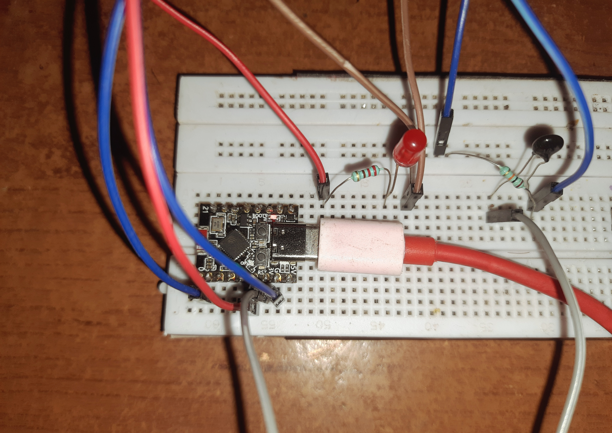
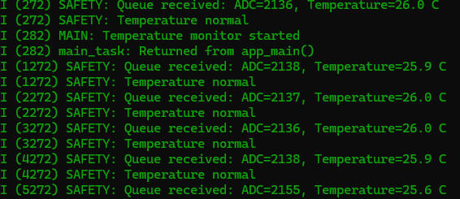
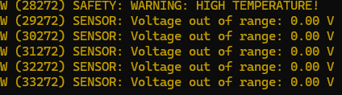

# ESP32-C3 FreeRTOS Queue - Temperature Monitor

A small embedded project using **ESP32-C3, FreeRTOS, and an NTC thermistor** to monitor temperature and trigger an LED warning.

## Features
- Temperature sensing using ADC
- Temperature calculation using the Beta equation
- FreeRTOS tasks for sensor reading and safety monitoring
- Queue-based communication between tasks
- LED warning when temperature reaches **50°C**
- ESP-IDF logging for system and sensor messages

## Circuit

## Hardware
- ESP32-C3
- 10K NTC thermistor
- 10K resistor
- LED with current-limiting resistor
- Breadboard and jumper wires

## Tech Stack
`C` · `ESP-IDF` · `FreeRTOS` · `ADC` · `GPIO`

## Key Learning
Implemented a producer-consumer design using a FreeRTOS queue, along with ADC-based sensing, temperature calculation, GPIO control, and ESP-IDF logging.
